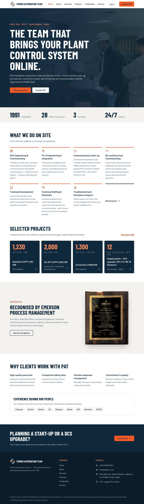
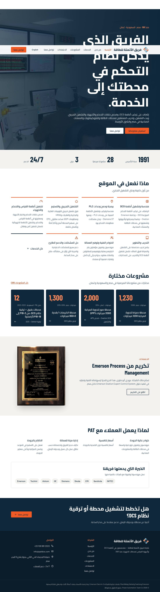
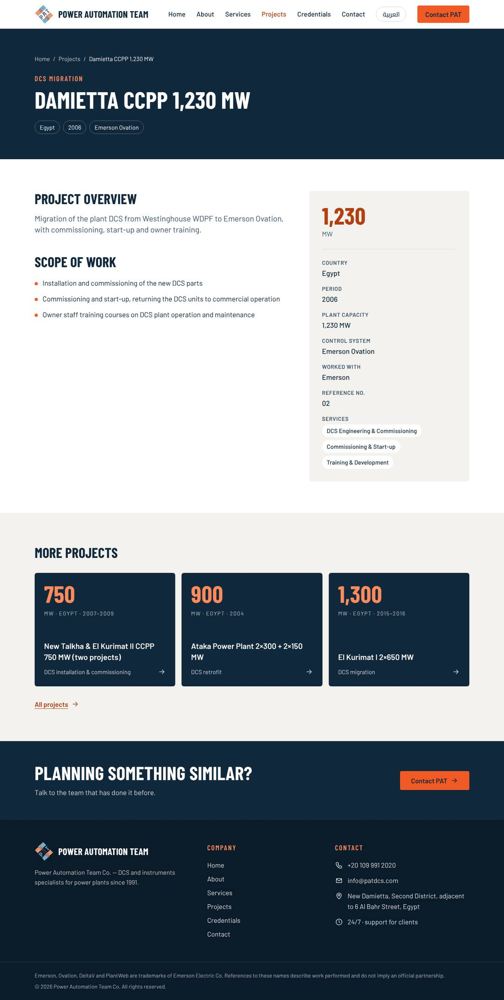
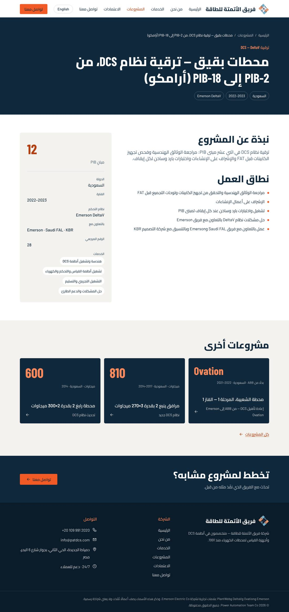
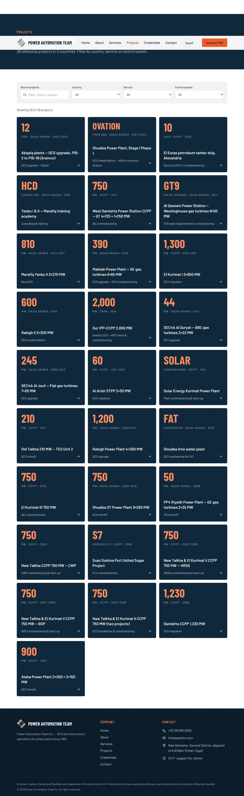
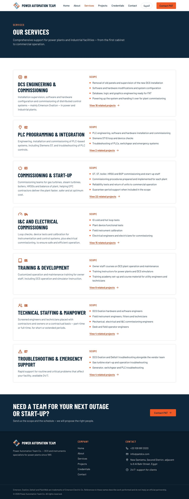
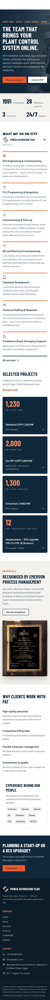

# PAT — Power Automation Team website

Bilingual (English / Arabic) company website for **Power Automation Team Co.** (patdcs.com) —
DCS commissioning and site services for power plants in Egypt, Saudi Arabia and Oman, since 1991.

Stack: **Next.js 16** (App Router, static generation) · **TypeScript** · **Tailwind CSS 4** ·
self-hosted fonts via Fontsource (Barlow, Barlow Condensed, Cairo). No database, no CMS.

## Preview

Screenshots of the production build (full-page captures).

| Home (EN) | Home (AR, RTL) |
|---|---|
|  |  |

| Project page (EN) | Project page (AR, RTL) |
|---|---|
|  |  |

| Project library | Services | Mobile |
|---|---|---|
|  |  |  |

## Run

```bash
npm install
npm run dev          # http://localhost:3000
npm run typecheck
npm run build && npm start
```

Copy `.env.example` to `.env.local` (site URL + contact-form e-mail delivery via Resend).
Without `RESEND_API_KEY` the form answers 503 and the page shows the direct e-mail address.

## Languages and URLs

| | English | Arabic |
|---|---|---|
| Home | `/` | `/ar` |
| About | `/about-us` | `/ar/about-us` |
| Services | `/services` | `/ar/services` |
| Projects | `/projects` | `/ar/projects` |
| Project page | `/projects/<slug>` | `/ar/projects/<slug>` |
| Credentials | `/credentials` | `/ar/credentials` |
| Contact | `/contact` | `/ar/contact` |

English stays at the root so the old WordPress URLs (`/about-us`, `/services`, `/projects`, `/contact`)
keep working. `src/proxy.ts` rewrites root paths to the internal `/en/*` route. Layout is RTL-aware
(logical Tailwind utilities, `dir` on `<html>`).

## Where things live

```
src/data/projects.ts    28 projects (EN + AR) — the single source for listing, pages, filters, sitemap
src/data/services.ts    7 services (EN + AR)
src/data/site.ts        company facts, contact details
src/data/clients.ts     "Trusted by" logo wall (contractors and plant owners)
src/i18n/en.ts, ar.ts   all UI copy (ar.ts is type-checked against en.ts)
src/lib/legacy.ts       old WordPress URLs → 410 Gone / redirect
src/lib/seo.ts          canonical, hreflang, Open Graph helpers
src/lib/schema.ts       JSON-LD (Organization, WebSite, BreadcrumbList)
src/proxy.ts            locale routing, legacy URLs, trailing-slash canonicalisation
public/images           real PAT photos only (no AI images) + Emerson plaque
public/images/site      site photos, region map   ┐ regenerated by scripts/site-assets.sh
public/images/clients   client logos              │ from brand/, profile/img and the
public/images/brand     lockups and weave device  ┘ success-stories deck
```

## Adding a project

Append an object to `projects` in `src/data/projects.ts` (see the existing entries). Its page,
card, filters, sitemap entry and breadcrumb data are generated automatically. Add photos by
putting files in `public/images/projects/` and listing them in the entry's `images` field —
the gallery only appears when images exist.

## More

- `docs/MIGRATION.md` — SEO, redirects, spam clean-up and go-live checklist.
- `docs/CONTENT-REVIEW.md` — facts and translations the owner should confirm before launch.
- `presentation/success-stories/` — editable PowerPoint of reference projects (see its README).
- `brand/` — logo suite, colours, typography, business card, letterhead, e-mail signature (see `brand/README.md`).
